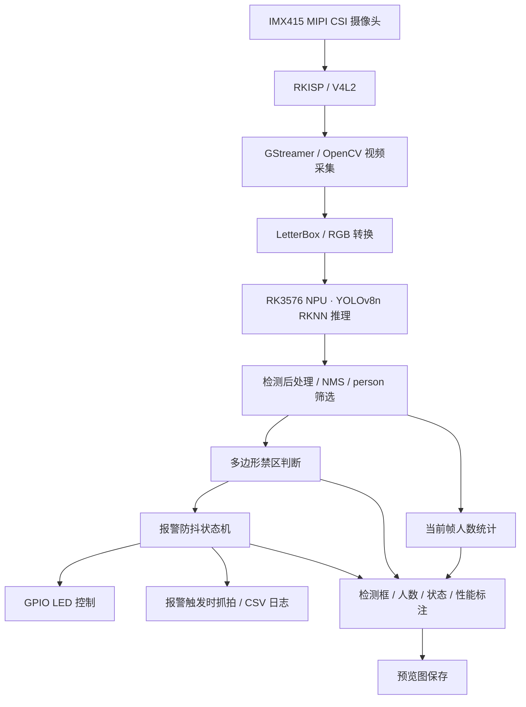
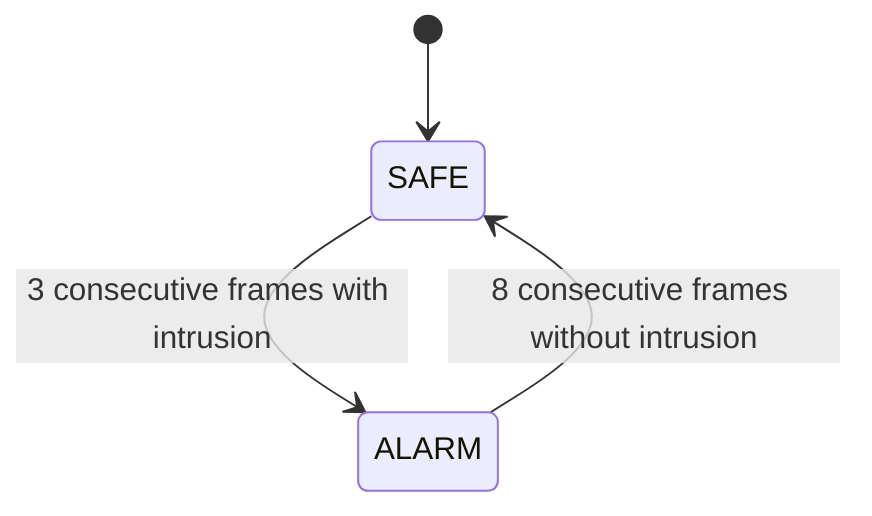

# 🛡️ LubanCat 3 × RK3576 NPU × YOLOv8 人员监测与禁区报警系统


基于 **野火 LubanCat 3（Rockchip RK3576）**、**IMX415 MIPI CSI 摄像头**和 **YOLOv8n（RKNN）** 开发的端侧智能视觉监测系统。通过 RKNN-Toolkit-Lite2 调用 NPU 进行模型推理，实现人员检测、当前画面人数统计、多边形禁区入侵判断、GPIO LED 报警、报警抓拍及 CSV 事件记录。

> **项目状态：已完成 RK3576 开发板实机部署、NPU 推理运行及 GPIO LED 硬件验证。**

本项目基于 [Rockchip RKNN Model Zoo](https://github.com/airockchip/rknn_model_zoo) 的 YOLOv8 示例进行扩展，面向嵌入式 Linux、边缘 AI 与软硬件协同开发场景。运行依赖 Model Zoo 的相关模块及板端 RKNN Runtime，并非独立的模型推理工具链。

## ✨ 核心功能

| 功能模块 | 实现方式 | 当前状态 |
| --- | --- | --- |
| 摄像头视频采集 | IMX415 + V4L2 + GStreamer + OpenCV | ✅ 板端实测 |
| YOLOv8n 人员检测 | RKNN-Lite2 调用 RK3576 NPU，筛选 COCO `person`（ID 0） | ✅ 板端实测 |
| 当前画面人数统计 | 统计每帧有效人员检测框 | ✅ 板端实测 |
| 多边形禁区判断 | 检测框底边中点与警戒区多边形的位置关系 | 代码已实现 |
| 报警防抖状态机 | 连续 3 帧检测到入侵触发报警，连续 8 帧禁区无人解除报警 | 代码已实现 |
| GPIO LED 报警 | Python `gpiod` 控制真实 GPIO 输出 | ✅ LED 硬件验证 |
| 报警抓拍 | 报警触发时保存带检测标注的现场图像 | 代码已实现 |
| CSV 事件记录 | 保存报警时间、总人数、禁区人数及抓拍文件名 | 代码已实现 |
| 性能信息展示 | 显示 NPU 单次推理耗时、程序运行帧率及报警状态 | ✅ 板端运行记录 |

说明：实测状态依据已有板端运行记录及 LED 硬件验证结果；完整的入侵触发、报警解除、抓拍及 CSV 写入联合测试记录待进一步补充。

## 📸 实机运行与验证

### 开发板运行结果

系统已部署于 LubanCat 3 开发板，通过 IMX415 摄像头采集视频，使用 RKNN-Lite2 在 RK3576 NPU 上运行 YOLOv8n，并进行 GPIO LED 硬件验证。

目前已有两种 `SAFE` 场景的运行记录：

| 观察指标 | 画面无人 | 检测到人员但未进入禁区 |
| --- | ---: | ---: |
| 画面人数 `Persons` | 0 | 1 |
| 禁区人数 `In Zone` | 0 | 0 |
| 人员检测置信度 | — | 0.65 |
| NPU 单次推理耗时 | 25 ms | 30 ms |
| 截图时程序帧率 | 15.0 FPS | 15.0 FPS |
| 报警状态 | `SAFE` | `SAFE` |

**性能说明：** 25–30 ms 和 15.0 FPS 是已有运行截图的观测值，不是经过长期基准测试的平均性能或稳定帧率。主程序中的 FPS 为启动处理循环以来的累计平均处理帧率，NPU 耗时仅统计 `rknn.inference()` 调用。

### 画面标注说明

- 橙色多边形：警戒区域。
- 绿色检测框：未进入警戒区的人员。
- 红色检测框：位于警戒区内的人员。
- 检测框底部圆点：用于禁区判断的脚部近似参考位置。
- `SAFE` / `ALARM ON`：报警状态机当前状态。

### GPIO LED 硬件验证

已完成实际 LED 硬件控制验证。当前仓库的 `led_control.py` 通过 `gpiod` 申请 GPIO 输出线路，并提供 `led_on()`、`led_off()` 两个控制接口，而不是仅打印报警信息的模拟适配器。


## 🧠 系统架构



模型前向计算由 NPU 执行，CPU 负责摄像头采集、图像预处理、检测后处理、禁区判断、报警逻辑及文件保存。

## 🧰 硬件与软件环境

| 项目 | 配置 |
| --- | --- |
| 开发板 | 野火 LubanCat 3（4 GB） |
| SoC | Rockchip RK3576 |
| NPU | 标称最高 6 TOPS |
| 摄像头 | 野火 IMX415 MIPI CSI |
| 操作系统 | Debian 12（bookworm） |
| CPU 架构 | ARM64 / aarch64 |
| Python | 3.11.2（项目记录版本） |
| 模型转换 | RKNN-Toolkit2 |
| 板端推理 | RKNN-Toolkit-Lite2 / RKNN Runtime |
| 检测模型 | YOLOv8n，RK3576 INT8 RKNN 模型 |
| 视频处理 | V4L2、GStreamer、OpenCV |
| 数据处理 | NumPy |
| 硬件报警 | GPIO LED / Python gpiod |
| 开发环境 | VS Code + Remote SSH |

其他系统、Python 版本或板卡需要重新核对驱动、运行时、模型及 GPIO 的兼容性。

## 📂 仓库结构

仓库主要目录及关键文件如下，实际文件以仓库内容为准：

```text
LubanCat3-YOLOv8-Guard/
├── README.md
├── .gitignore
├── python/
│   ├── imx415_guard.py      # 主程序：检测、人数、禁区、报警状态机
│   ├── led_control.py       # LED GPIO 控制适配器
│   ├── yolo_lubancat.py     # 项目所依赖的推理 / 后处理代码
│   ├── imx415_yolo.py      # 已有的摄像头 + YOLO 检测程序（建议保留）
│   ├── imx415_test.py      # 可选：摄像头单独测试
│   ├── convert.py
│   └── yolov8.py
├── docs/
│   └── images/
│       ├── no_person_safe.png
│       └── person_detected_safe.png
└── model/                  # 可选；模型文件需自行准备并核对许可
    └── yolov8n_rk3576_i8.rknn
```

`py_utils/` 和其他 Model Zoo 依赖应从上游项目获取。若对官方代码进行了修改，需注明来源并遵守原许可证；模型文件的使用和分发同样需要遵守其适用许可。

## 🚀 快速开始

以下命令使用项目原有的板端环境和目录约定，假设已经准备好 IMX415 摄像头、适配 RK3576 的 RKNN 模型、板端虚拟环境和 RKNN Model Zoo。其他设备请根据实际路径及硬件配置调整。

### 1. 检查板端 Python 环境

```bash
source ~/venvs/yolo/bin/activate

uname -m
python --version
python -m pip show rknn-toolkit-lite2
python -c "from rknnlite.api import RKNNLite; print('RKNNLite OK')"
python -c "import cv2, numpy, gpiod; print('Dependencies OK')"
```

RKNN-Toolkit-Lite2 安装包需要匹配板端 CPU 架构、Python 版本及 RKNN Runtime。GPIO 控制脚本使用 `gpiod` 1.x 风格接口；如环境使用 2.x API，需适配相关调用。

### 2. 准备 RKNN Model Zoo 依赖

上游仓库：

```bash
git clone https://github.com/airockchip/rknn_model_zoo.git ~/rknn_model_zoo
```

已有 Model Zoo 目录时无需重复克隆。确保使用与现有模型及运行时兼容的版本。

```bash
export RKNN_MODEL_ZOO_ROOT="$HOME/rknn_model_zoo"
export PYTHONPATH="$RKNN_MODEL_ZOO_ROOT${PYTHONPATH:+:$PYTHONPATH}"

python -c "from py_utils.coco_utils import COCO_test_helper; print('py_utils OK')"
```

将本项目所需的 Python 文件复制到 Model Zoo 的 YOLOv8 示例目录，并保留原有可正常运行的代码：

```text
~/rknn_model_zoo/
├── py_utils/
└── examples/
    └── yolov8/
        ├── model/
        │   └── yolov8n_rk3576_i8.rknn
        └── python/
            ├── imx415_guard.py
            ├── led_control.py
            ├── yolo_lubancat.py
            └── yolov8.py
```

### 3. 检查摄像头与 GPIO 配置

```bash
v4l2-ctl --list-devices

python -c "import cv2; print([x.strip() for x in cv2.getBuildInformation().splitlines() if 'GStreamer:' in x])"
```

- 确认 IMX415 摄像头、设备树和驱动工作正常。
- 确认 OpenCV 支持 GStreamer 视频采集。
- `/dev/video11` 为项目使用的默认视频节点，不保证适用于其他开发板。
- 确认模型已针对 RK3576 转换，且模型路径正确。
- 运行前检查 `led_control.py` 的 GPIO 参数、LED 有效电平、访问权限和引脚占用情况。

### 4. 启动人员监测程序

先进入项目部署目录：

```bash
cd ~/rknn_model_zoo/examples/yolov8/python
```

处理 150 帧：

```bash
python imx415_guard.py \
  --device /dev/video11 \
  --model ../model/yolov8n_rk3576_i8.rknn \
  --frames 150
```

持续运行（按 `Ctrl+C` 退出）：

```bash
python imx415_guard.py \
  --device /dev/video11 \
  --model ../model/yolov8n_rk3576_i8.rknn \
  --frames 0
```

### 5. 常用命令行参数

下列默认值与仓库中 `imx415_guard.py` 的参数定义一致。

| 参数 | 默认值 | 说明 |
| --- | --- | --- |
| `--device` | `/dev/video11` | 摄像头设备节点 |
| `--model` | `../model/yolov8n_rk3576_i8.rknn` | RKNN 模型文件 |
| `--frames` | `150` | 最大处理帧数；`0` 表示持续运行 |
| `--score` | `0.55` | 人员检测置信度阈值 |
| `--confirm-frames` | `3` | 报警触发所需连续入侵帧数 |
| `--clear-frames` | `8` | 报警解除所需连续无入侵帧数 |
| `--save-every` | `30` | 定期保存预览图的帧间隔；`0` 禁用定期保存 |
| `--output` | `guard_output` | 结果输出目录 |

## 🚧 核心实现

### 1. 人员检测与人数统计

在 RK3576 NPU 上执行 YOLOv8n 推理，复用 YOLOv8 后处理流程，并筛选 COCO 类别索引为 `0` 的人员检测结果。

系统分别统计当前画面中的总人数 `Persons` 和警戒区内人数 `In Zone`。

### 2. 多边形警戒区判断

禁区由归一化顶点坐标定义。当前代码中的默认警戒区为：

```python
ZONE = [
    (0.28, 0.34),
    (0.73, 0.34),
    (0.85, 0.91),
    (0.18, 0.91),
]
```

将归一化坐标映射至图像尺寸后，取人体检测框 `(x1, y1, x2, y2)` 的底边中点：

```text
foot_x = (x1 + x2) / 2
foot_y = y2
```

使用 `cv2.pointPolygonTest()` 判断该点是否位于警戒区内部或边界上。摄像头位置发生变化时，可调整 `ZONE` 适配实际监测画面。

### 3. 报警防抖状态机

通过 `AlarmFilter` 维护连续入侵帧数、连续无入侵帧数及当前报警状态，避免单帧检测波动导致 LED 频繁切换。



| 状态转换 | 程序动作 |
| --- | --- |
| 初始化 | LED 关闭 |
| 连续 3 帧禁区内有人 | 进入报警状态，调用 `led_on()`，保存抓拍并尝试写入 CSV |
| 保持报警 | LED 保持报警状态，不重复触发事件记录 |
| 连续 8 帧禁区内无人 | 解除报警，调用 `led_off()` |
| 正常退出 / 进入清理流程的异常退出 | 尝试关闭 LED，释放摄像头、NPU 及 GPIO 资源 |

上述触发帧数为默认配置，可通过命令行参数调整。无入侵帧指禁区内无人，并非整个画面必须无人。

### 4. GPIO LED 硬件控制

`led_control.py` 通过 Python `gpiod` 接口管理 GPIO 输出，当前仓库代码中的配置如下：

| 配置项 | 当前代码值 |
| --- | --- |
| `CHIP_NUMBER` | `1` |
| `LINE_OFFSET` | `24` |
| `LED_ON` | `1` |
| `LED_OFF` | `0` |

即当前代码使用 GPIO 控制器 1、线路偏移 24，并配置高电平点亮、低电平熄灭。

程序通过 `led_on()` 和 `led_off()` 控制报警灯，初始化 GPIO 时默认关闭 LED，并注册退出清理函数。

**硬件适配说明：** 上表是仓库代码配置，不代表所有 LubanCat 3 或其他 RK3576 板卡的 LED 引脚均相同。应根据实际硬件原理图、已验证的 GPIO 接线及有效电平配置，不要直接套用到其他设备。使用外接 LED 时也应确认 GPIO 电气规格及限流要求。

## 🔧 常见问题

| 现象 | 排查方向 |
| --- | --- |
| `No module named 'rknnlite'` | 检查虚拟环境、Python 版本及 Lite2 安装 |
| `No module named 'py_utils'` | 检查 Model Zoo 目录及 `PYTHONPATH` |
| VS Code 提示导入失败但终端运行正常 | 选择板端正确的 Python 解释器，检查 Pylance 路径配置 |
| 摄像头无画面 | 检查 IMX415 驱动、MIPI 接线、视频节点及 GStreamer 管线 |
| OpenCV 无法使用 GStreamer | 查看 `cv2.getBuildInformation()` |
| RKNN 模型加载失败 | 检查模型目标平台、文件路径及 Runtime 兼容性 |
| LED 无反应或亮灭逻辑相反 | 检查 GPIO chip、line offset、有效电平、权限、线路占用及 gpiod API 版本 |
| 未生成 `events.csv` | 检查是否真正触发报警、图片是否保存成功及输出目录是否可写 |
| FPS 较低 | 分别排查视频采集、图像预处理、NPU 推理、后处理与文件保存的开销 |

## 📚 参考项目与致谢

- [Rockchip RKNN Model Zoo](https://github.com/airockchip/rknn_model_zoo)
- [RKNN Model Zoo YOLOv8 示例](https://github.com/airockchip/rknn_model_zoo/tree/main/examples/yolov8)
- [Rockchip RKNN-Toolkit2](https://github.com/airockchip/rknn-toolkit2)
- [野火 RK3576 摄像头开发文档](https://doc.embedfire.com/linux/rk3576/quick_start/zh/latest/doc/camera/camera.html)

感谢 Rockchip、野火及相关开源项目提供的开发工具、示例和技术文档。第三方代码、模型及资料遵循其各自适用的许可证及版权声明。

## 🤝 交流与贡献

欢迎通过 [Issues](https://github.com/LQ719/LubanCat3-YOLOv8-Guard/issues) 或 Pull Request 交流嵌入式 Linux、RKNN NPU 部署、YOLOv8 与 GPIO 控制相关问题。

项目作者：[LQ719](https://github.com/LQ719)
