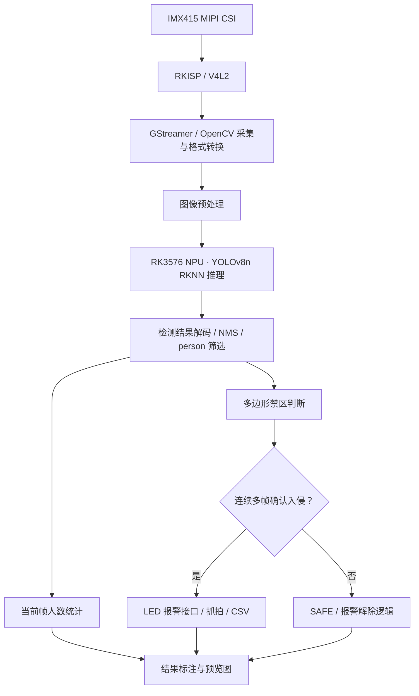

# 🛡️ LubanCat 3 × RK3576 NPU × YOLOv8 人员监测与禁区报警系统

基于 **野火 LubanCat 3（Rockchip RK3576）**、**IMX415 MIPI CSI 摄像头**和 **YOLOv8n（RKNN）** 的端侧视觉监测项目。系统面向人员检测、当前画面人数统计、禁区入侵判断，并预留 GPIO LED 报警、报警抓拍和 CSV 事件记录功能。

> **项目定位：** 嵌入式 Linux / 边缘 AI 学习与原型验证。该项目基于 [Rockchip RKNN Model Zoo](https://github.com/airockchip/rknn_model_zoo) 的 YOLOv8 示例扩展，**不是独立于 Model Zoo 即可运行的完整推理工具链**。
>
> **验证说明：** 已有资料记录了 RKNNLite 导入成功、静态图与 IMX415 视频检测，以及两种 `SAFE` 状态的演示截图；**真实禁区报警、硬件 LED 联动、抓拍和 CSV 全流程仍需板端验证**。下文不会把单帧截图数据当作平均性能。

## ✨ 功能概览

| 功能 | 实现方式 |
| --- | --- |
| YOLOv8 人员检测 | RK3576 NPU 执行 YOLOv8n RKNN 推理，筛选 COCO `person`（ID 0） |
| 当前画面人数统计 | 统计当前帧的人员检测框数量 |
| 多边形警戒区域 | 人员框**底边中点**与禁区多边形进行位置判断 |
| 报警防抖 | 连续 3 帧判定有人入区后报警，连续 8 帧无入区人员后解除 |
| GPIO LED 报警 | 通过 `led_control.py` 接入实际 GPIO |
| 报警抓拍与 CSV 记录 | 保存带框抓拍与事件时间、人数等字段 |
| 性能信息展示 | NPU 单次耗时与程序 FPS |

## 📸 演示结果

已有文档整理了两张实际运行画面的观察结果：

| 指标 | 无人状态 | 检测到人员但未进入警戒区 |
| --- | ---: | ---: |
| 当前画面人数 `Persons` | 0 | 1 |
| 警戒区人数 `In Zone` | 0 | 0 |
| 人员检测置信度 | — | 0.65 |
| NPU 单次推理耗时 | 25 ms | 30 ms |
| 截图时程序帧率 | 15.0 FPS | 15.0 FPS |
| 系统状态 | `SAFE` | `SAFE` |

画面中，**橙色梯形**为警戒区域，**绿色检测框**标出人员；框底部的绿色点表示用于区域判断的参考位置。

**注意：** 25/30 ms 与 15.0 FPS 只是这两张截图中的观测值，不能据此认定长期平均性能、稳定帧率或整套报警链路已经验证。当前暂无 `In Zone: 1` 或 LED 实际点亮的演示证据。

将真实截图放到仓库中的 `docs/images/` 后，可取消以下 Markdown 图片引用的注释：

<!--


-->

## 🧠 系统流程



模型前向计算由 NPU 执行；摄像头采集、图像格式处理、检测后处理、区域判断和文件保存等工作还会使用 CPU。

## 🧰 硬件与软件环境

| 项目 | 项目记录 |
| --- | --- |
| 开发板 | 野火 LubanCat 3，4 GB 版本 |
| SoC | Rockchip RK3576 |
| NPU | 标称最高 6 TOPS（**不是实测 FPS**） |
| 摄像头 | 野火 IMX415 MIPI CSI |
| 操作系统 | Debian 12（bookworm），ARM64 / aarch64 |
| Python | 3.11.2 |
| 开发方式 | VS Code + Remote SSH |
| 推理工具链 | 电脑端 RKNN-Toolkit2；板端 RKNN-Toolkit-Lite2 / RKNN Runtime |
| 模型 | YOLOv8n → ONNX → RKNN，示例采用 INT8 模型 |
| 视频链路 | MIPI CSI / RKISP / V4L2 / GStreamer / OpenCV |
| LED | GPIO；具体 chip、line offset、有效电平需实机确认 |

以上为项目记录中的环境，其他系统或版本需要自行验证兼容性。早期检查曾记录 RKNN Runtime `2.1.0`、NPU 驱动 `0.9.8`，不代表当前设备仍使用这些版本。

## 📂 建议的 GitHub 仓库结构

```text
LubanCat3-YOLOv8-Guard/
├── README.md
├── .gitignore
├── python/
│   ├── imx415_guard.py      # 主程序：检测、人数、禁区、报警状态机
│   ├── led_control.py       # LED GPIO 控制适配器
│   ├── yolo_lubancat.py     # 项目所依赖的推理 / 后处理代码
│   ├── imx415_yolo.py      # 已有的摄像头 + YOLO 检测程序（建议保留）
│   ├── imx415_test.py      # 可选：摄像头单独测试
│   ├── convert.py
│   └── yolov8.py
├── docs/
│   └── images/
│       ├── no_person_safe.png
│       └── person_detected_safe.png
└── model/                  # 可选；模型文件需自行准备并核对许可
    └── yolov8n_rk3576_i8.rknn
```

这是**推荐组织方式**，不是对当前已上传代码文件的核验。请只提交自己确实拥有的源文件，并根据实际文件名调整结构。

- `imx415_guard.py`、`led_control.py` 和 `yolo_lubancat.py` 是建议优先公开的项目代码。
- `imx415_yolo.py` 便于复现已有摄像头检测链路，`imx415_test.py` 有助于单独排查摄像头。
- 官方 `yolov8.py` 与 `py_utils/` 可以从 RKNN Model Zoo 获取，**不必重复上传未经修改的第三方源码**。如果对其做了修改，应注明来源、改动并遵守原许可。
- `convert.py` 若包含**自己的模型转换配置或改动**，可放在 `tools/` 并说明如何使用；若只是官方原版，则给出上游链接即可。
- `.rknn` / `.onnx` 模型是否分发取决于文件大小、来源和许可证；默认不将其视为必传代码。

## 🚀 快速开始

以下示例假设开发板上已有 `~/rknn_model_zoo`、`~/venvs/yolo`，且 IMX415 摄像头和 RKNN 模型已准备好。**实际路径以你的设备为准。**

### 1. 检查 Python / RKNN 环境

在 LubanCat 3 的终端执行：

```bash
source ~/venvs/yolo/bin/activate

uname -m
python --version
python -m pip show rknn-toolkit-lite2
python -c "from rknnlite.api import RKNNLite; print('RKNNLite OK')"
```

已有项目记录确认：`yolo` 虚拟环境中可以成功导入 `RKNNLite`。但它不等于摄像头、模型和报警程序已全部通过测试。

RKNN-Toolkit-Lite2 必须与开发板 CPU 架构、Python 版本和运行时兼容；不要直接照搬其他架构的 wheel 包。

### 2. 准备 RKNN Model Zoo 依赖

本项目部分脚本引用：

```python
from py_utils.coco_utils import COCO_test_helper
```

确保 `py_utils/coco_utils.py` 位于 Model Zoo 根目录下，例如：

```text
~/rknn_model_zoo/
├── py_utils/
│   └── coco_utils.py
└── examples/
    └── yolov8/
        ├── model/
        └── python/
            └── yolov8.py
```

在当前终端设置路径：

```bash
export RKNN_MODEL_ZOO_ROOT="$HOME/rknn_model_zoo"
export PYTHONPATH="$RKNN_MODEL_ZOO_ROOT${PYTHONPATH:+:$PYTHONPATH}"

python -c "from py_utils.coco_utils import COCO_test_helper; print('py_utils OK')"
```

`PYTHONPATH` 设置仅对当前终端及其子进程生效；重新打开终端后需要再次设置。也可以在 Python 主程序中做路径定位，但应先核对实际仓库层级。

### 3. 将项目代码放入已验证的 YOLOv8 示例目录

建议先保留原本能运行的 `imx415_yolo.py`，不要覆盖或删除它。

把本仓库的 `python/` 目录中需要的文件复制到：

```text
~/rknn_model_zoo/examples/yolov8/python/
```

至少确认该目录下有：

```text
python/
├── imx415_guard.py
├── led_control.py
├── yolo_lubancat.py
└── yolov8.py                # Model Zoo 示例代码
```

`py_utils/` 则仍位于 Model Zoo 根目录。根据你实际的 `import` 语句，可能还需要保留其他原有模块。

### 4. 检查摄像头和模型

```bash
v4l2-ctl --list-devices

python -c "import cv2; print([x.strip() for x in cv2.getBuildInformation().splitlines() if 'GStreamer:' in x])"
```

- 确认 IMX415 接线、设备树和驱动已生效。
- 确认 GStreamer 可采集，且 Python 使用的 OpenCV 构建支持 GStreamer。
- `/dev/video11` 是**项目中使用过的示例节点**，并非所有设备都适用；请使用实际的 `rkisp_mainpath` 或已验证视频节点。
- 确认 `.rknn` 模型已经针对 **RK3576** 转换，并放置在命令指定的位置。

### 5. 启动检测

在 `~/rknn_model_zoo/examples/yolov8/python/` 目录：

```bash
python imx415_guard.py \
  --device /dev/video11 \
  --model ../model/yolov8n_rk3576_i8.rknn \
  --frames 150
```

持续运行（`Ctrl+C` 退出）：

```bash
python imx415_guard.py \
  --device /dev/video11 \
  --model ../model/yolov8n_rk3576_i8.rknn \
  --frames 0
```

> 命令行选项来自已有项目文档。由于这里未提供 `.py` 源码进行逐项核对，**最终应以你实际提交的 `imx415_guard.py` 中的 `argparse` 定义为准**。同样，应让新主程序使用已验证的摄像头 GStreamer pipeline。

### 常用参数（项目文档中的示例）

| 参数 | 文档示例默认值 | 作用 |
| --- | --- | --- |
| `--device` | `/dev/video11` | 摄像头视频节点 |
| `--model` | `../model/yolov8n_rk3576_i8.rknn` | RKNN 模型路径 |
| `--frames` | `150` | 最大处理帧数；`0` 表示持续运行 |
| `--score` | `0.55` | `person` 检测置信度阈值 |
| `--confirm-frames` | `3` | 连续多少帧检测入区后触发报警 |
| `--clear-frames` | `8` | 连续多少帧确认无入区人员后清除报警 |
| `--save-every` | `30` | 定期保存预览图的帧间隔 |
| `--output` | `guard_output` | 保存结果的目录 |

## 🚧 禁区判断与报警逻辑

### 多边形区域

已有项目文档使用归一化坐标定义禁区：

```python
ZONE = [
    (0.28, 0.34),
    (0.73, 0.34),
    (0.85, 0.91),
    (0.18, 0.91),
]
```

每个点为 `(x 比例, y 比例)`，范围 `0～1`。程序将其换算为图像像素坐标，并使用 `cv2.pointPolygonTest()` 检查**检测框底边中点**是否在禁区内。

这里的“底边中点”只是脚部位置的近似值，受到遮挡、拍摄视角以及检测框误差影响；它不是精确的地面落点。

### 状态机与 LED

```text
连续 3 帧有人进入禁区 → 报警状态 ON → 调用 led_on()，并按程序设计抓拍/记录
报警保持期间         → 不必每帧重新申请 GPIO
连续 8 帧禁区无人     → 报警状态 OFF → 调用 led_off()
程序正常或异常退出    → 尝试灭灯，并释放摄像头与 NPU 资源
```

`led_control.py` 需要对外提供：

```python
def led_on():
    ...

def led_off():
    ...
```

**重要：** 文档中的 LED 适配器可能只有打印模拟，并没有真正控制灯。接入真实 GPIO 前，需要实机验证 GPIO chip、line offset、有效高/低电平、权限及 `gpiod` API 版本。**不要直接假设某个 `gpiochip` / line 编号就是 LED 引脚。**

## 🗃️ 输出文件

按现有程序设计，运行目录下可能生成：

```text
guard_output/
├── preview.jpg                 # 定期更新的预览图
├── intrusion_YYYYMMDD_*.jpg    # 报警触发时的截图
└── events.csv                  # 首次报警触发后创建
```

`events.csv` 的字段含义：

| 字段 | 含义 |
| --- | --- |
| `time` | 报警时间 |
| `persons` | 报警时当前画面人数 |
| `in_zone` | 报警时警戒区人数 |
| `snapshot` | 对应抓拍文件名 |

这些是**预期输出**，并非本 README 对硬件端实测文件的确认。

## 🔧 常见问题

| 现象 | 排查方向 |
| --- | --- |
| VS Code 提示 `reportMissingImports`，但终端导入成功 | 通过 **Python: Select Interpreter** 选择远程板端虚拟环境，再重载窗口 |
| 运行时 `No module named 'rknnlite'` | 检查虚拟环境、Python 版本及 Lite2 安装 |
| 运行时 `No module named 'py_utils'` | 检查 `rknn_model_zoo/py_utils` 是否存在，以及 `PYTHONPATH` / `sys.path` |
| Pylance 仍提示找不到 `py_utils` | 为编辑器配置 `python.analysis.extraPaths`；它**不会**自动修改运行时 `sys.path` |
| 找不到 IMX415 或无画面 | 检查 MIPI 接线、设备树、`dmesg`、`v4l2-ctl --list-devices` 及正确视频节点 |
| GStreamer 可采集但 OpenCV 打不开 | 检查当前 `cv2` 构建是否支持 GStreamer |
| 检测框错位 | 核查 RGB/BGR、LetterBox、后处理与坐标还原 |
| `.rknn` 模型加载失败 | 核对 RK3576 目标、Toolkit2 / Lite2 / Runtime 的兼容性 |
| LED 没反应或亮灭逻辑相反 | 检查当前是否为模拟适配器、GPIO 引脚、电平、权限及占用情况 |
| FPS 不达预期 | 分别测试采集、预处理、NPU、后处理和文件保存开销 |

VS Code 的静态导入提示与 Python 运行时的导入失败不是同一个问题。开发机上的绝对路径、SSH 地址和个人环境设置不要提交到公开仓库。

## ⚠️ 已知限制

- `Persons` 是**当前单帧检测到的人数**，并非跨帧去重后的累计客流量。
- 目前未记录人员跟踪 ID；漏检、遮挡和重复框可能影响统计。
- “人员进入禁区”基于框底边中点，无法替代精确的人员位置估计。
- 已有截图不足以证明稳定的 15 FPS，更不能据此宣称 30 FPS。
- 尚未提供真实入侵触发、LED 点亮、事件 CSV 与异常恢复的完整验证记录。
- 原型项目不应在缺乏充分测试时用作安全关键场景的唯一报警手段。

## 📚 参考项目与致谢

- [Rockchip RKNN Model Zoo](https://github.com/airockchip/rknn_model_zoo)
- [Rockchip RKNN Model Zoo · YOLOv8 示例](https://github.com/airockchip/rknn_model_zoo/tree/main/examples/yolov8)
- [Rockchip RKNN-Toolkit2](https://github.com/airockchip/rknn-toolkit2)
- [野火 RK3576 摄像头开发文档](https://doc.embedfire.com/linux/rk3576/quick_start/zh/latest/doc/camera/camera.html)

本项目在 Rockchip / 野火相关工具、文档及示例基础上开发。上传含第三方代码、模型或图片的文件前，请先核对相应版权与许可证，并保留必要的声明。

## 交流与贡献

欢迎通过 Issue 或 Pull Request 交流项目实现思路、提出问题或参与改进。

## 联系

- 项目作者：[LQ719 （LQ719）](https://github.com/LQ719)
